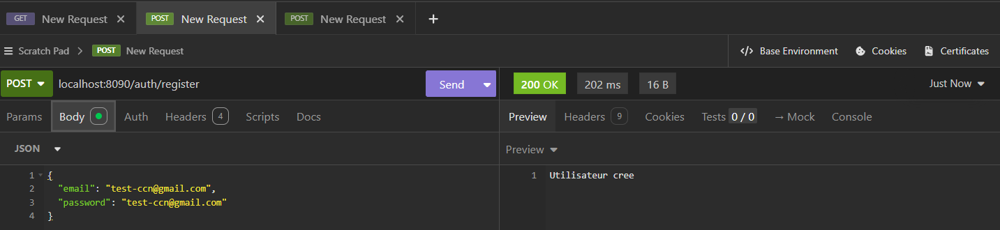
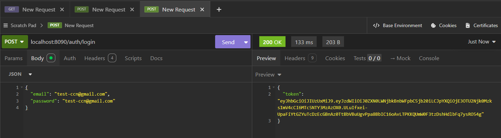
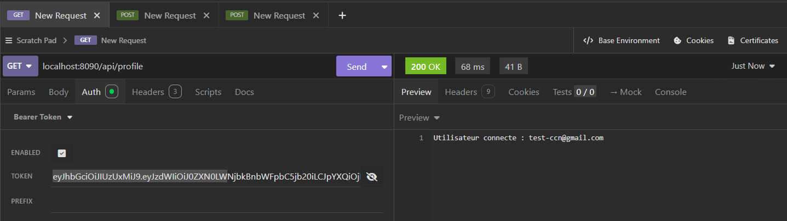

# TP 2 — Authentification avec JWT et Spring Security

Ce projet est une petite API REST Spring Boot qui montre comment inscrire un utilisateur, vérifier ses identifiants et protéger des routes avec un jeton JWT. Il met en place un flux d’authentification sans session côté serveur : après la connexion, le client renvoie le jeton avec ses requêtes protégées.

## Objectifs et fonctionnement

Le parcours illustré par l’application est le suivant :

1. **Inscription** — `POST /auth/register` crée un compte à partir d’une adresse e-mail et d’un mot de passe. Le mot de passe est encodé avec BCrypt avant son enregistrement ; le rôle attribué par défaut est `USER`.
2. **Connexion** — `POST /auth/login` transmet les identifiants à Spring Security. En cas d’authentification réussie, l’API signe un JWT contenant le sujet (l’adresse e-mail), sa date d’émission et son expiration, puis le renvoie au client.
3. **Accès protégé** — pour appeler `/api/**`, le client envoie l’en-tête `Authorization: Bearer <jeton>`. Le filtre vérifie le jeton et charge l’utilisateur ; Spring Security rend alors son identité disponible aux contrôleurs.

La configuration est sans état (`STATELESS`) : le serveur ne conserve pas de session d’authentification entre les requêtes. Les routes `/auth/**` et `/h2-console/**` sont publiques dans cette démonstration ; les routes `/api/**` exigent une authentification.

## Technologies

- Java 17 et Spring Boot 4.1.2
- Spring Web MVC, Spring Security et Spring Data JPA
- H2 en mémoire pour le stockage de démonstration
- JJWT 0.13.0 pour créer et vérifier les JWT
- Maven, avec le Maven Wrapper fourni dans le dépôt

## Structure du projet

Les classes Java se trouvent sous `src/main/java/ma/formation/tp2/`.

| Classe | Rôle |
| --- | --- |
| `Tp2Application` | Point d’entrée Spring Boot ; démarre l’application et le conteneur Spring. |
| `config/SecurityConfig` | Déclare l’encodeur BCrypt, l’`AuthenticationManager`, les règles d’accès HTTP, le mode sans session et l’emplacement du filtre JWT dans la chaîne de sécurité. |
| `controller/AuthController` | Expose l’inscription et la connexion sous `/auth`. Il vérifie l’unicité de l’e-mail, enregistre le mot de passe encodé et renvoie un jeton après authentification. |
| `controller/UserController` | Expose deux routes protégées sous `/api` : un message d’accueil et le profil de l’utilisateur authentifié. |
| `dto/RegisterRequest` | Objet de requête (record Java) contenant l’e-mail et le mot de passe d’inscription. |
| `dto/LoginRequest` | Objet de requête contenant l’e-mail et le mot de passe de connexion. |
| `dto/AuthResponse` | Objet de réponse contenant le JWT émis après une connexion réussie. |
| `entity/AppUser` | Entité JPA persistée dans la table `users`, avec identifiant, e-mail, mot de passe encodé et rôle. |
| `repository/UserRepository` | Repository Spring Data JPA ; fournit notamment la recherche et la vérification d’existence d’un compte par e-mail. |
| `service/CustomUserDetailsService` | Adapte les utilisateurs stockés à l’interface `UserDetailsService` utilisée par Spring Security. |
| `service/JwtService` | Génère les JWT, extrait leur sujet et vérifie leur signature ainsi que leur expiration. |
| `security/JwtFilter` | Filtre chaque requête une seule fois ; lit le Bearer token, valide l’utilisateur et établit son authentification pour la requête. |
| `src/test/.../Tp2ApplicationTests` | Test de démarrage vérifiant que le contexte Spring de l’application peut être chargé. |

La configuration applicative est dans `src/main/resources/application.properties` : port `8090`, base H2 en mémoire, console H2, secret et durée de validité du JWT. Le fichier `pom.xml` déclare les dépendances ainsi que les outils de test.

## Démarrer l’application

Depuis la racine du projet, avec un JDK 17 installé :

```powershell
.\mvnw.cmd spring-boot:run
```

L’API est alors disponible sur `http://localhost:8090`. Pour exécuter le test existant :

```powershell
.\mvnw.cmd test
```

## Essayer l’API

### 1. Créer un compte

```http
POST http://localhost:8090/auth/register
Content-Type: application/json

{
  "email": "demo@example.com",
  "password": "mot-de-passe-de-demo"
}
```

Une inscription réussie renvoie `Utilisateur cree`. L’adresse e-mail est unique ; une adresse déjà utilisée produit une réponse `400`.

### 2. Se connecter

```http
POST http://localhost:8090/auth/login
Content-Type: application/json

{
  "email": "demo@example.com",
  "password": "mot-de-passe-de-demo"
}
```

La réponse contient un objet JSON avec le champ `token`. Utilisez la valeur reçue pour les appels protégés.

### 3. Appeler une route protégée

```http
GET http://localhost:8090/api/profile
Authorization: Bearer <jeton-reçu-à-la-connexion>
```

`GET /api/hello` est également protégé et renvoie un message d’accueil. Sans jeton valide, les routes `/api/**` ne sont pas accessibles.

## Démonstration

Les captures ci-dessous montrent les réponses `200 OK` obtenues lors des essais de l’inscription, de la connexion et de l’accès au profil. Il s’agit des données de test de la démonstration.

### Inscription réussie



### Connexion et émission du JWT



### Accès au profil authentifié



## Base de données de démonstration

La base H2 est configurée en mémoire (`jdbc:h2:mem:securitydb`) : les comptes sont donc perdus au redémarrage de l’application. La console est disponible à `http://localhost:8090/h2-console`, avec l’URL JDBC `jdbc:h2:mem:securitydb`, l’utilisateur `sa` et un mot de passe vide.

## Limites et précautions

Ce dépôt est un exercice pédagogique, pas une configuration de production. Le secret JWT fourni dans `application.properties` est une valeur de démonstration : en production, il faut le remplacer par un secret fort fourni hors du dépôt (par exemple via une variable d’environnement) et le protéger. Il faut également ajouter la validation des entrées, des réponses d’erreur adaptées, des tests couvrant les cas d’authentification et une base de données persistante si le besoin l’exige.
